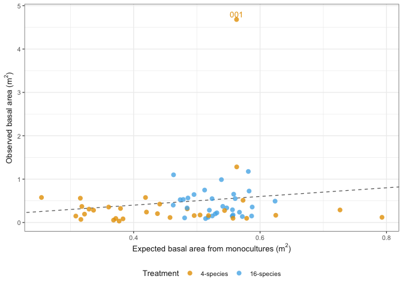
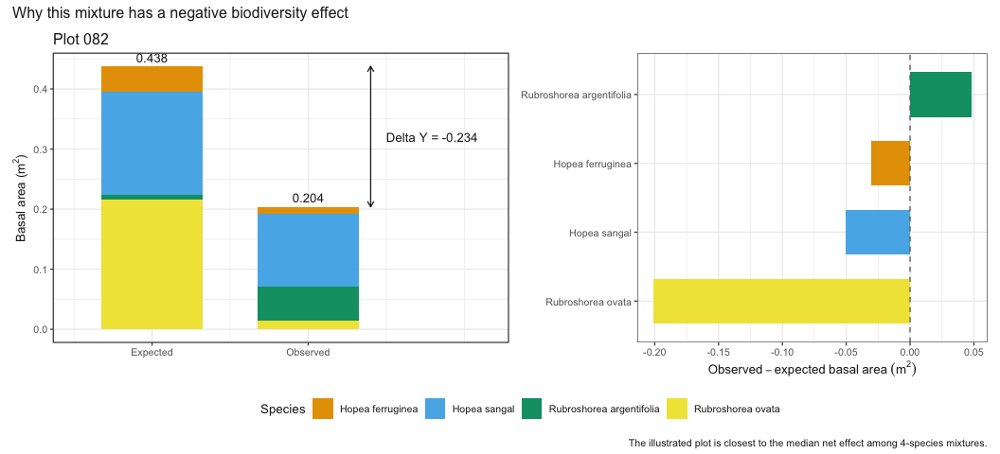

# Why can the biodiversity effect be negative when basal area does not decline with richness?
eleanorjackson
26 October, 2026

- [The two analyses ask different
  questions](#the-two-analyses-ask-different-questions)
- [Reconstruct observed and expected basal
  area](#reconstruct-observed-and-expected-basal-area)
- [Visual explanation for one mixture
  plot](#visual-explanation-for-one-mixture-plot)
- [A worked 16-species example](#a-worked-16-species-example)
- [Check against `densize()`](#check-against-densize)
- [Interpretation](#interpretation)

``` r
library("tidyverse")
library("patchwork")
```

``` r
data <- read_rds(
    here::here("data", "derived", "data_cleaned.rds")
) |>
    filter(treatment != "16-species-cut")
```

## The two analyses ask different questions

The species-richness analysis asks whether the **observed total basal
area** in the 3rd census changes among the 1-, 4-, and 16-species
treatments. The biodiversity partition asks whether each mixture has
more or less basal area than expected from the monoculture performance
of the species planted in that particular mixture.

For the partition method, first, basal area is summed for species $i$
within each plot:

$$
Y_{ji} = \sum_k BA_{jik},
$$

where $k$ indexes trees, $i$ indexes species, and $j$ indexes plots. The
monoculture yield $M_i$ is then the **mean of these plot-level sums**
across the two monoculture plots for species $i$. Mean refers to
averaging replicate monoculture plots, not averaging trees.

For mixture plot $j$, the expected yield is

$$
Y_{E,j} = \sum_i p_{ji}M_i,
$$

where $p_{ji}$ is the initial relative abundance of species $i$ in that
plot. The observed yield and net biodiversity effect are

$$
Y_{O,j} = \sum_i Y_{ji}, \qquad
\Delta Y_j = Y_{O,j} - Y_{E,j}.
$$

Consequently, a negative biodiversity effect means that a mixture
produced less basal area than expected from its component species in
monoculture. It does not mean that basal area must decline from 1 to 4
to 16 species (which is what we test with the basal area ~ sp richness
model).

## Reconstruct observed and expected basal area

This first calculation reproduces the species-level final-yield matrix
passed to `densize()`: basal area is summed within every plot and
species at census 3.

``` r
final_yield_species <- data |>
    filter(census_no == "03") |>
    mutate(basal_area_m2 = pi * (dbase_mm / 2000)^2) |>
    summarise(
        observed_species_ba = sum(basal_area_m2, na.rm = TRUE),
        .by = c(
            block,
            plot,
            treatment,
            species_mix,
            genus_species
        )
    )
```

To represent the previous census as the initial community, count the
living trees of each species at census 2. The total initial count does
not enter the expectation directly; `densize()` converts these counts to
relative abundances $p_{ji}$.

``` r
initial_composition <- data |>
    filter(census_no == "02") |>
    summarise(
        initial_density = sum(survival),
        .by = c(plot, genus_species)
    ) |>
    mutate(
        initial_proportion = initial_density / sum(initial_density),
        .by = plot
    )
```

For each species, calculate $M_i$, its mean total basal area across its
two monoculture plots.

``` r
monoculture_yield <- final_yield_species |>
    filter(treatment == "1-species") |>
    summarise(
        monoculture_ba = mean(observed_species_ba),
        n_monoculture_plots = n(),
        .by = genus_species
    )

monoculture_yield |>
    arrange(desc(monoculture_ba)) |>
    knitr::kable(digits = 3)
```

| genus_species            | monoculture_ba | n_monoculture_plots |
|:-------------------------|---------------:|--------------------:|
| Rubroshorea_beccariana   |          1.487 |                   2 |
| Rubroshorea_macrophylla  |          1.028 |                   2 |
| Rubroshorea_ovalis       |          1.009 |                   2 |
| Rubroshorea_leprosula    |          0.946 |                   2 |
| Rubroshorea_ovata        |          0.889 |                   2 |
| Hopea_sangal             |          0.597 |                   2 |
| Parashorea_malaanonan    |          0.549 |                   2 |
| Parashorea_tomentella    |          0.376 |                   2 |
| Rubroshorea_johorensis   |          0.327 |                   2 |
| Dryobalanops_lanceolata  |          0.311 |                   2 |
| Rubroshorea_macroptera   |          0.264 |                   2 |
| Richetia_gibbosa         |          0.211 |                   2 |
| Dipterocarpus_conformis  |          0.157 |                   2 |
| Hopea_ferruginea         |          0.125 |                   2 |
| Richetia_faguetiana      |          0.116 |                   2 |
| Rubroshorea_argentifolia |          0.065 |                   2 |

Next, weight each species’ monoculture yield by its initial proportion
in each mixture. Summing these species-level expectations gives the
expected basal area for the whole mixture plot.

``` r
expected_species_yield <- initial_composition |>
    left_join(
        monoculture_yield,
        by = join_by(genus_species),
        relationship = "many-to-one",
        unmatched = "error"
    ) |>
    mutate(
        expected_species_ba = initial_proportion * monoculture_ba
    )

observed_plot_yield <- final_yield_species |>
    summarise(
        observed_ba = sum(observed_species_ba),
        .by = c(block, plot, treatment, species_mix)
    )

expected_plot_yield <- expected_species_yield |>
    summarise(
        expected_ba = sum(expected_species_ba),
        .by = plot
    )

plot_comparison <- observed_plot_yield |>
    filter(treatment != "1-species") |>
    left_join(
        expected_plot_yield,
        by = join_by(plot),
        relationship = "one-to-one"
    ) |>
    mutate(net_effect = observed_ba - expected_ba)

stopifnot(!anyNA(plot_comparison$expected_ba))
```

The arithmetic means make the apparent disparity clear.

``` r
observed_summary <- observed_plot_yield |>
    summarise(
        mean_observed_ba = mean(observed_ba),
        median_observed_ba = median(observed_ba),
        .by = treatment
    )

partition_summary <- plot_comparison |>
    summarise(
        mean_observed_ba = mean(observed_ba),
        mean_expected_ba = mean(expected_ba),
        mean_net_effect = mean(net_effect),
        median_net_effect = median(net_effect),
        proportion_positive = mean(net_effect > 0),
        .by = treatment
    )

observed_summary |>
    knitr::kable(digits = 3)
```

| treatment  | mean_observed_ba | median_observed_ba |
|:-----------|-----------------:|-------------------:|
| 4-species  |            0.417 |              0.222 |
| 1-species  |            0.529 |              0.367 |
| 16-species |            0.422 |              0.347 |

``` r
partition_summary |>
    knitr::kable(digits = 3)
```

| treatment | mean_observed_ba | mean_expected_ba | mean_net_effect | median_net_effect | proportion_positive |
|:---|---:|---:|---:|---:|---:|
| 4-species | 0.417 | 0.451 | -0.035 | -0.207 | 0.188 |
| 16-species | 0.422 | 0.533 | -0.111 | -0.190 | 0.344 |

In our data, mean basal area across plots declined from one to four
species and then increased slightly from four to sixteen species. Our
basal area ~ species richness model imposed a single log-linear trend
across the three richness levels and adjusted for block. It estimated a
weak positive multiplicative trend, although its confidence interval
included no species richness effect. The biodiversity partition
addresses a different, additive comparison: observed mixture basal area
was below the composition-weighted yield expected from monocultures.
Thus, the slight modelled richness trend does not indicate that mixtures
exceeded their monoculture expectations. For the sixteen-species plots,
this expectation incorporates monoculture yields from the complete
species pool.

``` r
plot_comparison |>
    ggplot(aes(x = expected_ba, y = observed_ba, colour = treatment)) +
    geom_abline(slope = 1, intercept = 0, linetype = 2, colour = "grey40") +
    geom_point(size = 2.5, alpha = 0.8) +
    geom_text(
        data = plot_comparison |> filter(plot == "001"),
        aes(label = plot),
        nudge_y = 0.12,
        show.legend = FALSE
    ) +
    #coord_equal() +
    labs(
        x = expression("Expected basal area from monocultures (" * m^2 * ")"),
        y = expression("Observed basal area (" * m^2 * ")"),
        colour = "Treatment"
    )
```



Points below the one-to-one line have negative net biodiversity effects.
Most plots fall below the line, even though there is no strong decline
in observed basal area between the two mixture richness levels. Plot 001
is an important positive outlier and pulls the arithmetic mean for the
4-species treatment upwards.

## Visual explanation for one mixture plot

For a concise illustration, select the 4-species plot whose net
biodiversity effect is closest to the treatment median. This avoids
choosing an unusually large positive or negative result. In the left
panel, each coloured section is one species. The expected bar contains
$p_iM_i$, whereas the observed bar contains the summed basal area of
that species in the mixture. The right panel shows the difference
between those two quantities for each species.

``` r
representative_plot <- plot_comparison |>
    filter(treatment == "4-species") |>
    slice_min(
        abs(net_effect - median(net_effect)),
        with_ties = FALSE
    ) |>
    pull(plot)

representative_components <- expected_species_yield |>
    filter(plot == representative_plot) |>
    left_join(
        final_yield_species |>
            select(plot, genus_species, observed_species_ba),
        by = join_by(plot, genus_species),
        relationship = "one-to-one"
    ) |>
    mutate(
        species = genus_species |>
            str_replace_all("_", " ") |>
            str_to_sentence(),
        species_net_effect = observed_species_ba - expected_species_ba
    )

stopifnot(!anyNA(representative_components$observed_species_ba))

figure_bars <- representative_components |>
    select(
        species,
        expected_species_ba,
        observed_species_ba
    ) |>
    pivot_longer(
        cols = c(expected_species_ba, observed_species_ba),
        names_to = "yield_type",
        values_to = "basal_area"
    ) |>
    mutate(
        yield_type = recode(
            yield_type,
            expected_species_ba = "Expected",
            observed_species_ba = "Observed"
        ),
        bar_position = if_else(yield_type == "Expected", 1, 2)
    )

figure_totals <- figure_bars |>
    summarise(
        total_basal_area = sum(basal_area),
        bar_position = first(bar_position),
        .by = yield_type
    )

figure_annotation <- figure_totals |>
    summarise(
        expected_ba = total_basal_area[yield_type == "Expected"],
        observed_ba = total_basal_area[yield_type == "Observed"],
        net_effect = observed_ba - expected_ba,
        label_y = mean(c(expected_ba, observed_ba))
    )

total_plot <- figure_bars |>
    ggplot(aes(
        x = bar_position,
        y = basal_area,
        fill = species
    )) +
    geom_col(width = 0.65) +
    geom_text(
        data = figure_totals,
        aes(
            x = bar_position,
            y = total_basal_area,
            label = sprintf("%.3f", total_basal_area)
        ),
        inherit.aes = FALSE,
        vjust = -0.5
    ) +
    geom_segment(
        data = figure_annotation,
        aes(
            x = 2.4,
            xend = 2.4,
            y = observed_ba,
            yend = expected_ba
        ),
        inherit.aes = FALSE,
        arrow = grid::arrow(
            ends = "both",
            length = grid::unit(0.07, "inches")
        )
    ) +
    geom_text(
        data = figure_annotation,
        aes(
            x = 2.5,
            y = label_y,
            label = sprintf("Delta Y = %.3f", net_effect)
        ),
        inherit.aes = FALSE,
        hjust = 0
    ) +
    scale_x_continuous(
        breaks = c(1, 2),
        labels = c("Expected", "Observed"),
        limits = c(0.5, 3.15)
    ) +
    labs(
        title = paste("Plot", representative_plot),
        x = NULL,
        y = expression("Basal area (" * m^2 * ")"),
        fill = "Species"
    ) +
    coord_cartesian(clip = "off")

species_plot <- representative_components |>
    mutate(species_ordered = fct_reorder(species, species_net_effect)) |>
    ggplot(aes(
        x = species_net_effect,
        y = species_ordered,
        fill = species
    )) +
    geom_col(width = 0.65, show.legend = FALSE) +
    geom_vline(xintercept = 0, linetype = 2, colour = "grey40") +
    labs(
        x = expression(Observed - expected ~ basal ~ area ~ (m^2)),
        y = NULL
    )

total_plot +
    species_plot +
    plot_layout(widths = c(1.3, 1), guides = "collect") +
    plot_annotation(
        title = "Why this mixture has a negative biodiversity effect",
        caption = paste(
            "The illustrated plot is closest to the median net effect",
            "among 4-species mixtures."
        )
    ) &
    theme(legend.position = "bottom")
```



The total observed basal area is lower than the monoculture-based
expectation, so $\Delta Y$ is negative. The species-level panel shows
that positive contributions from some species are insufficient to
compensate for negative contributions from others.

## A worked 16-species example

The following table selects the 16-species plot whose net effect is
closest to the treatment median. It shows how the species-level
expectations add up to a negative plot-level effect.

``` r
example_plot <- plot_comparison |>
    filter(treatment == "16-species") |>
    slice_min(
        abs(net_effect - median(net_effect)),
        with_ties = FALSE
    ) |>
    pull(plot)

example_species <- expected_species_yield |>
    filter(plot == example_plot) |>
    left_join(
        final_yield_species |>
            select(plot, genus_species, observed_species_ba),
        by = join_by(plot, genus_species),
        relationship = "one-to-one"
    ) |>
    mutate(
        species_net_effect = observed_species_ba - expected_species_ba
    ) |>
    select(
        genus_species,
        initial_proportion,
        monoculture_ba,
        expected_species_ba,
        observed_species_ba,
        species_net_effect
    ) |>
    arrange(species_net_effect)

stopifnot(!anyNA(example_species$observed_species_ba))

example_species |>
    knitr::kable(
        digits = 3,
        col.names = c(
            "Species",
            "Initial proportion",
            "Monoculture BA",
            "Expected BA",
            "Observed BA",
            "Net effect"
        )
    )
```

| Species | Initial proportion | Monoculture BA | Expected BA | Observed BA | Net effect |
|:---|---:|---:|---:|---:|---:|
| Rubroshorea_leprosula | 0.077 | 0.946 | 0.073 | 0.005 | -0.068 |
| Parashorea_malaanonan | 0.148 | 0.549 | 0.081 | 0.038 | -0.043 |
| Rubroshorea_ovalis | 0.046 | 1.009 | 0.047 | 0.010 | -0.037 |
| Rubroshorea_macrophylla | 0.049 | 1.028 | 0.050 | 0.014 | -0.036 |
| Rubroshorea_beccariana | 0.046 | 1.487 | 0.069 | 0.034 | -0.035 |
| Hopea_sangal | 0.117 | 0.597 | 0.070 | 0.039 | -0.031 |
| Dryobalanops_lanceolata | 0.088 | 0.311 | 0.027 | 0.009 | -0.019 |
| Rubroshorea_macroptera | 0.060 | 0.264 | 0.016 | 0.009 | -0.006 |
| Hopea_ferruginea | 0.084 | 0.125 | 0.010 | 0.004 | -0.006 |
| Rubroshorea_ovata | 0.038 | 0.889 | 0.033 | 0.029 | -0.004 |
| Richetia_gibbosa | 0.026 | 0.211 | 0.006 | 0.003 | -0.003 |
| Richetia_faguetiana | 0.007 | 0.116 | 0.001 | 0.000 | -0.001 |
| Dipterocarpus_conformis | 0.011 | 0.157 | 0.002 | 0.004 | 0.002 |
| Rubroshorea_argentifolia | 0.029 | 0.065 | 0.002 | 0.007 | 0.005 |
| Parashorea_tomentella | 0.071 | 0.376 | 0.027 | 0.034 | 0.007 |
| Rubroshorea_johorensis | 0.104 | 0.327 | 0.034 | 0.098 | 0.064 |

``` r
example_species |>
    summarise(
        plot = example_plot,
        expected_ba = sum(expected_species_ba),
        observed_ba = sum(observed_species_ba),
        net_effect = sum(species_net_effect)
    ) |>
    knitr::kable(digits = 3)
```

| plot | expected_ba | observed_ba | net_effect |
|:-----|------------:|------------:|-----------:|
| 038  |       0.547 |       0.336 |     -0.211 |

Species with negative values in the final column contribute less basal
area than expected from their monoculture yield. Positive contributions
from other species need not be large enough to compensate, producing a
negative total for the plot.

## Check against `densize()`

The direct calculation above should equal the sum of the four components
returned by `densize()` (up to numerical rounding).

``` r
stored_effects <- read_rds(
    here::here("data", "derived", "biodiv_effects.rds")
) |>
    select(plot, densize_net_effect = net)

partition_check <- plot_comparison |>
    select(plot, direct_net_effect = net_effect) |>
    left_join(
        stored_effects,
        by = join_by(plot),
        relationship = "one-to-one",
        unmatched = "error"
    ) |>
    mutate(difference = direct_net_effect - densize_net_effect)

partition_check |>
    summarise(maximum_absolute_difference = max(abs(difference))) |>
    knitr::kable(digits = 12)
```

| maximum_absolute_difference |
|----------------------------:|
|                           0 |

`densize()` and our calculations above give the same answer.

## Interpretation

In the biodiversity partition each mixture is compared with an expected
yield calculated from the mean plot-level yield of its component species
in monoculture, weighted by their initial relative abundances. Thus,
basal area can remain similar across richness treatments while the
biodiversity effect is negative, because the mixtures produce less basal
area than their composition-specific monoculture expectations.

> Total basal area did not differ strongly between the 4- and 16-species
> treatments. Nevertheless, mixtures generally had less basal area than
> expected from the monoculture yields of their component species. This
> is not a contradiction: the richness comparison concerns observed plot
> totals, whereas the net biodiversity effect compares each observed
> mixture with a composition-specific monoculture counterfactual.
